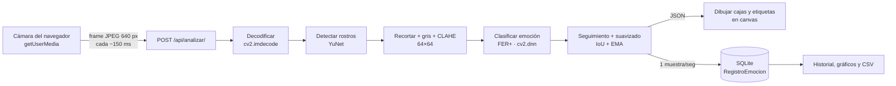

# EmoVisión: detección de emociones en tiempo real

Aplicación web en **Django** que captura video de la cámara desde el navegador, lo procesa con **OpenCV** para **detectar rostros** y **reconocer la emoción** de cada uno, y muestra los resultados en vivo sobre el video. Cada sesión de análisis se guarda en la base de datos y se puede revisar luego en un historial con estadísticas, gráficos y exportación a CSV.

<!-- Agregar capturas en docs/capturas/ y descomentar:


-->

---

## Funcionalidades

| Módulo | Qué hace |
|---|---|
| **Cámara en vivo** | Captura video con la cámara del navegador y envía frames al servidor unas 6 veces por segundo |
| **Detección de rostros** | Localiza todos los rostros del frame con la red neuronal **YuNet** (`cv2.FaceDetectorYN`) |
| **Reconocimiento de emociones** | Clasifica cada rostro en 8 emociones con el modelo **FER+** cargado con `cv2.dnn`: neutral, felicidad, sorpresa, tristeza, enojo, disgusto, miedo y desprecio |
| **Procesamiento** | Mejora el contraste del rostro con CLAHE, sigue cada rostro entre frames (IoU) y suaviza los resultados (media móvil exponencial) para que la etiqueta no parpadee |
| **Resultados sobre el video** | Caja de color por emoción, con emoji y porcentaje de confianza, y barras de probabilidad en vivo |
| **Sesiones** | Cada vez que se inicia la cámara se crea una sesión con nombre; se guarda una muestra por rostro por segundo |
| **Historial y estadísticas** | Emoción predominante, duración, rostros, índice de ánimo, gráfico en el tiempo, distribución y resumen por rostro |
| **Exportar CSV** | Descarga todos los registros de una sesión con las 8 probabilidades |
| **Panel de administración** | Consulta y filtra sesiones y registros desde `/admin` |

> **Privacidad:** no se guarda ninguna imagen ni foto de rostros. Solo se almacenan los resultados numéricos del análisis.

---

## Tecnologías

| Componente | Tecnología |
|---|---|
| Lenguaje backend | Python 3.14 |
| Framework web | Django 6.1 |
| Visión por computadora | OpenCV 5.0 (`opencv-python`) y NumPy |
| Detector de rostros | YuNet, de OpenCV Zoo (ONNX, ~230 KB) |
| Clasificador de emociones | FER+, de ONNX Model Zoo (ONNX, ~34 MB) |
| Base de datos | SQLite |
| Frontend | HTML, CSS y JavaScript; Chart.js 4.4.1 incluido localmente, sin depender de internet |

No se usa TensorFlow ni PyTorch: toda la inferencia se ejecuta con el módulo `dnn` de OpenCV.

---

## Instalación y ejecución

### Requisitos previos
- Python 3.12 o superior (probado con 3.14)
- Git
- Una cámara web y un navegador moderno (Chrome, Edge o Firefox)

### Pasos

```bash
# 1. Clonar el repositorio
git clone https://github.com/LuisVillegas440/proyecto01_opencv_cs_emociones.git
cd proyecto01_opencv_cs_emociones

# 2. Crear y activar el entorno virtual
python -m venv venv
venv\Scripts\activate          # Windows
# source venv/bin/activate     # Linux / macOS

# 3. Instalar dependencias
pip install -r requirements.txt

# 4. Crear la base de datos
python manage.py migrate

# 5. (Opcional) Crear un usuario para el panel de administración
python manage.py createsuperuser

# 6. Iniciar el servidor
python manage.py runserver
```

Abrir **http://127.0.0.1:8000/** y presionar **«Iniciar cámara»**. El navegador pedirá permiso para usar la cámara.

> Los modelos `.onnx` ya vienen en la carpeta `modelos_ml/`; no hay que descargar nada más.
> La cámara solo funciona en `localhost`/`127.0.0.1` o con HTTPS, por una restricción de seguridad de los navegadores.

### Páginas

| URL | Descripción |
|---|---|
| `/` | Cámara en vivo con detección |
| `/historial/` | Lista de sesiones guardadas |
| `/historial/<id>/` | Estadísticas y gráficos de una sesión |
| `/historial/<id>/csv/` | Descarga del CSV de la sesión |
| `/admin/` | Panel de administración de Django |

---

## Cómo funciona



1. **Captura:** el navegador obtiene el video con `getUserMedia`, reduce cada frame a 640 px de ancho, lo comprime a JPEG y lo envía al servidor. Solo hay una petición en curso a la vez, así el servidor nunca se satura.
2. **Detección:** YuNet devuelve la caja de cada rostro y su confianza. Se descartan rostros menores a 24 px.
3. **Preprocesado:** cada rostro se recorta con un 10 % de margen, se pasa a escala de grises, se redimensiona a 64×64 y se le aplica **CLAHE** (ecualización adaptativa del histograma) para compensar la poca luz.
4. **Reconocimiento:** FER+ procesa todos los rostros del frame en una sola pasada y devuelve 8 puntuaciones, que se convierten en probabilidades con *softmax*.
5. **Seguimiento y suavizado:** cada rostro se asocia con el del frame anterior por solapamiento (IoU) y conserva un **id estable**. Sus probabilidades se promedian con una **media móvil exponencial**, lo que evita que la etiqueta cambie a cada instante.
6. **Visualización:** la API responde en JSON y el navegador dibuja las cajas sobre el video en modo espejo, además de las barras de probabilidad.
7. **Persistencia:** si hay una sesión activa, se guarda como máximo una muestra por segundo para no llenar la base de datos.

**Rendimiento medido:** unos 43 ms por frame (detección y clasificación) a 640×480 en CPU.

---

## Estructura del proyecto

```
proyecto01_opencv_cs_emociones/
├── config/                     # Configuración del proyecto Django
│   ├── settings.py             #   rutas a los modelos y umbral de detección al final
│   └── urls.py
├── emociones/                  # Aplicación principal
│   ├── vision/                 # Módulo de OpenCV, independiente de Django (reutilizable)
│   │   ├── detector_rostros.py #   YuNet: frame → lista de rostros
│   │   ├── clasificador.py     #   FER+: recorte → probabilidades de 8 emociones
│   │   ├── seguimiento.py      #   asociación entre frames (IoU) y suavizado (EMA)
│   │   └── pipeline.py         #   orquesta todo y es seguro con varios hilos
│   ├── models.py               # SesionAnalisis, RegistroEmocion
│   ├── views.py                # Páginas y API
│   ├── servicios.py            # Carga única de los modelos
│   ├── registro.py             # Guardado limitado a 1 muestra/segundo
│   ├── estadisticas.py         # Cálculos del historial (funciones puras)
│   ├── presentacion.py         # Etiqueta, emoji y color de cada emoción
│   ├── admin.py                # Panel de administración
│   ├── templates/emociones/    # base, camara, historial, sesion_detalle
│   ├── static/emociones/       # css, js (camara.js, sesion.js) y Chart.js
│   └── tests/                  # Pruebas automáticas
│       ├── unitarias/          #   funciones y clases aisladas (OpenCV, estadísticas…)
│       ├── integracion/        #   rutas de Django de punta a punta
│       ├── funcionales/        #   casos de uso en navegador real (Playwright)
│       └── utilidades.py       #   datos de prueba compartidos
├── modelos_ml/                 # Modelos ONNX (YuNet y FER+)
├── manage.py
├── requirements.txt
└── README.md
```

### Modelo de datos

| Tabla | Campos | Descripción |
|---|---|---|
| `SesionAnalisis` | nombre, descripción, inicio, fin | Un período de análisis, desde «Iniciar» hasta «Detener» |
| `RegistroEmocion` | sesión, momento, rostro_id, emoción, confianza, probabilidades (JSON) | Una muestra de un rostro, como máximo una por segundo |

---

## Pruebas

### Pruebas automáticas

```bash
pip install -r requirements-dev.txt                     # una vez: agrega Playwright

python manage.py test emociones                         # todas (42)
python manage.py test emociones.tests.unitarias         # solo unitarias (16)
python manage.py test emociones.tests.integracion       # solo integración (19)
python manage.py test emociones.tests.funcionales       # solo funcionales (7)
```

> Las pruebas funcionales usan Microsoft Edge o Google Chrome si están instalados; si no, ejecutar `playwright install chromium`. Sin Playwright, esas 7 pruebas se omiten y el resto se ejecuta igual.

**Pruebas unitarias** (`emociones/tests/unitarias/`): prueban una función o clase de forma aislada.

| Archivo | Qué verifica |
|---|---|
| `test_vision.py` | Que existan los modelos, la detección con y sin rostro, que las probabilidades sumen 1, el lote vacío, el pipeline completo y las imágenes inválidas |
| `test_seguimiento.py` | El cálculo de IoU, el id estable y el suavizado, que un rostro lejano reciba un id nuevo y el descarte de rostros perdidos |
| `test_estadisticas.py` | La emoción predominante, el índice de ánimo, la línea de tiempo, el límite de puntos y las sesiones vacías |
| `test_modelos.py` | La emoción predominante calculada desde la base de datos |

**Pruebas de integración** (`emociones/tests/integracion/`): recorren el flujo URL → vista → OpenCV / base de datos → respuesta.

| Archivo | Qué verifica |
|---|---|
| `test_rutas.py` | Que la cámara, el historial y el detalle carguen correctamente, y el error 404 |
| `test_api_analizar.py` | La API con un frame válido, sin frame, con imagen inválida, con el método incorrecto y con un rostro real |
| `test_sesiones.py` | Iniciar y finalizar sesiones, el guardado limitado a 1 muestra/segundo y que no se guarde nada en sesiones cerradas |
| `test_admin.py` | Los listados y el detalle del panel de administración |
| `test_exportar_csv.py` | El formato, las columnas y el contenido del CSV |

**Pruebas funcionales** (`emociones/tests/funcionales/`): levantan el servidor, abren un navegador real sin ventana y usan una **cámara simulada** (un video generado a partir de una imagen) para recorrer los casos de uso como lo haría un usuario. Cada prueba guarda una captura de pantalla en `evidencias/funcionales/`.

| Caso de uso | Qué se valida |
|---|---|
| CU-01 Inicio | La página carga con sus controles, las 8 emociones y la navegación |
| CU-02 Detección en video | Al iniciar la cámara se detecta el rostro, se dibuja el recuadro sobre el video, las probabilidades suman 100 % y el análisis alcanza al menos 2 análisis por segundo |
| CU-03 Sesión y resultados | Al detener se guarda la sesión con sus registros, y el detalle muestra las tarjetas y los gráficos |
| CU-04 Historial y CSV | La sesión aparece en el historial y el CSV se descarga con el contenido correcto |
| CU-05 Sin rostro | Sin personas frente a la cámara, el sistema sigue conectado, sin errores y sin guardar registros |
| CU-06 Permiso denegado | Si se bloquea la cámara se muestra un mensaje claro y no se crea ninguna sesión |
| CU-07 Administración | Un administrador inicia sesión en /admin/ y ve las sesiones con su duración, registros y emoción predominante |

En todas se verifica además que la página no registre errores de JavaScript ni respuestas HTTP con error.

Para ver el navegador mientras se ejecutan, por ejemplo en una demostración:

```bash
set PRUEBAS_VISIBLES=1                                   # Windows (cmd)
python manage.py test emociones.tests.funcionales
```

### Reporte de pruebas y cobertura

```bash
python herramientas/reporte_pruebas.py
```

Ejecuta todas las pruebas midiendo la **cobertura de código** (qué porcentaje del código de la aplicación se ejecuta durante las pruebas) y genera en `evidencias/`:

| Archivo | Contenido |
|---|---|
| `reporte_pruebas.html` | Resumen por tipo de prueba, detalle de cada una con su descripción y tiempo, cobertura por archivo y capturas de las pruebas funcionales |
| `log_pruebas.txt` | Log completo de la ejecución |
| `cobertura.txt` | Cobertura por archivo en texto |
| `cobertura_html/index.html` | Cobertura línea por línea |
| `funcionales/*.png` | Capturas tomadas por las pruebas funcionales |

Última ejecución: **42 pruebas aprobadas y 99 % de cobertura**. El script termina con código de salida 1 si alguna prueba falla.

### Pruebas manuales

Casos para comprobar el comportamiento con la cámara real:

| # | Caso | Resultado esperado |
|---|---|---|
| 1 | Buena iluminación, 1 persona | Detecta el rostro y la emoción cambia con los gestos |
| 2 | Poca luz o luz lateral | Sigue detectando, quizá con menor confianza |
| 3 | 2–3 personas | Una caja por persona, cada una con su emoción |
| 4 | Nadie frente a la cámara | Panel en «Sin rostro», sin errores |
| 5 | Rostro de perfil o cubierto | No se cae; puede perder el rostro un momento |
| 6 | Permiso de cámara denegado | Mensaje claro en pantalla |
| 7 | Detener e iniciar de nuevo | Se crea una sesión nueva |
| 8 | Cerrar la pestaña sin detener | La sesión queda finalizada en el historial |
| 9 | Exportar CSV y abrirlo en Excel | Se ven bien las tildes y las columnas |

---

## Limitaciones conocidas

- FER+ funciona mejor con **rostros frontales** y buena luz. Las emociones *desprecio* y *disgusto* se detectan con menos frecuencia porque había pocos ejemplos de ellas en el conjunto de entrenamiento.
- El seguimiento entre frames es simple (por solapamiento). Si una persona sale de cuadro y vuelve, recibe un id nuevo.
- La aplicación está pensada para ejecutarse **localmente** con el servidor de desarrollo de Django.
- Se usa **SQLite** por simplicidad. Para usar PostgreSQL solo hay que cambiar `DATABASES` en `config/settings.py` e instalar `psycopg`.

---

## Créditos

- **YuNet**: detector de rostros de [OpenCV Zoo](https://github.com/opencv/opencv_zoo/tree/main/models/face_detection_yunet).
- **FER+ (emotion-ferplus-8)**: modelo de [ONNX Model Zoo](https://github.com/onnx/models/tree/main/validated/vision/body_analysis/emotion_ferplus), entrenado con el conjunto FER+ de Microsoft.
- **Chart.js**: [chartjs.org](https://www.chartjs.org/).
- Imagen de prueba (`emociones/tests/imagenes/con_rostro.jpg`): muestra `messi5.jpg` de los [ejemplos de OpenCV](https://github.com/opencv/opencv/tree/4.x/samples/data).

Las licencias de cada modelo y librería se pueden consultar en sus repositorios originales.
